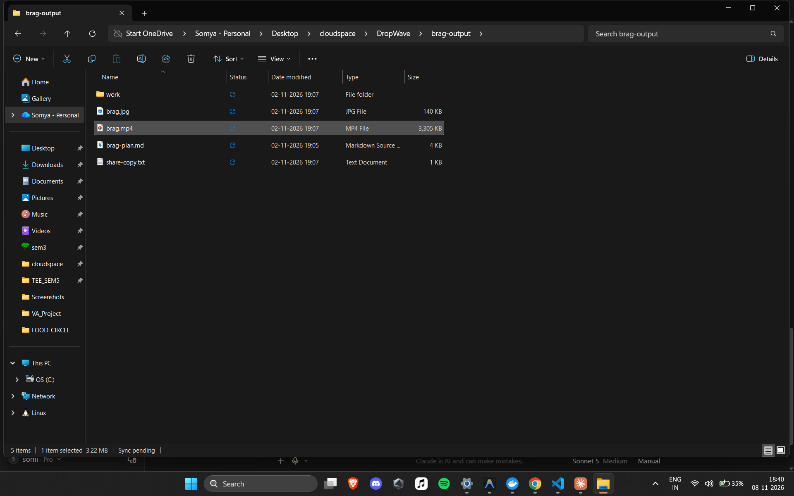

# DropWave

> **Drop a file. It lands anywhere.**

A production-grade, cross-platform **peer-to-peer file-sharing PWA**. It runs identically
in the browser on **iOS, Android, Windows, and macOS** — zero installs, zero accounts.
File bytes travel **device-to-device over an encrypted WebRTC DataChannel and never touch
a server.**

It solves the everyday pain of moving a file between an iPhone and a Windows PC, which
AirDrop can't do and email/cloud make slow and account-bound.

**Live demo:** [dropwave-five.vercel.app](https://dropwave-five.vercel.app)

---

## Demo

https://github.com/user-attachments/assets/9f0050b8-a121-4701-b51d-de916c039c11



---

## Why it's different

| | DropWave | AirDrop | Snapdrop / PairDrop |
|---|---|---|---|
| iPhone ↔ Windows | ✅ | ❌ | ✅ |
| No install / no account | ✅ | ✅ (Apple only) | ✅ |
| Files never hit a server | ✅ (WebRTC P2P) | ✅ | ✅ |
| End-to-end encrypted | ✅ (DTLS by default) | ✅ | ✅ |
| Premium, "alive" UX | ✅ | — | ❌ (utilitarian) |

### The honest bit
Pairing happens by **scanning a QR code** (or typing a short room code). That's the
unavoidable price of "no install, runs in any browser" — browsers **cannot** silently
discover devices on your LAN the way AirDrop can. DropWave is the smoothest version that
genuinely works iPhone ↔ Windows with nothing to download. We never imply raw LAN
auto-discovery.

---

## How it works (architecture)

```
┌──────────┐ SDP/ICE ┌─────────────────┐ SDP/ICE ┌──────────┐
│ Device A │ ────────────▶ │ signaling server│ ◀─────────── │ Device B │
│ (sender) │ │ (Node + ws) │ │(receiver)│
└────┬─────┘ └─────────────────┘ └────┬─────┘
│ handshake relay only │
│ — never sees files — │
└────────── encrypted WebRTC DataChannel (P2P) ─────────────┘
⬆ ALL FILE BYTES TRAVEL HERE
```

1. **Pairing.** The sender creates a room and shows a **QR code + room code**. The
receiver **scans the QR** (camera) or **types the code**. This exchange goes through a
tiny **signaling server** whose only job is to relay the WebRTC handshake (SDP/ICE).
2. **Connection.** The two browsers negotiate a direct **WebRTC DataChannel** using STUN
for ICE. On the same Wi-Fi the path stays **local** — no internet round-trips for the
data, and it works offline.
3. **Transfer.** Files are **chunked** (the sender negotiates the largest safe chunk up
from the SCTP transport — up to **1 MiB**, falling back to a 16 KiB iOS-Safari-safe
floor) and streamed over the DataChannel with **backpressure** so memory stays bounded
and the UI stays at 60fps. Reads are **pipelined** (the next chunk loads off disk while
the current one sends) to keep a fast LAN saturated. On the receiver, picking a
destination folder streams each file **straight to disk**, so **100 files × 1 GB+
(100 GB+)** moves with flat memory use. Multiple files per session; either side can
send more **without re-pairing**.

**Privacy invariant:** the signaling server only ever sees small JSON handshake blobs.
It cannot see file names or bytes. Once the channel opens it's out of the loop entirely.
WebRTC DataChannels are encrypted (DTLS) by default.

### Local Wi-Fi mode (high speed, optional)

Flip on **Local Wi-Fi** before pairing (a toggle on Send, mirrored on Receive) to force a
**STUN-only, no-relay** connection. When both devices are on the same network the path
becomes a direct host-to-host LAN link — the **fastest** possible and bytes never leave
your network. It's off by default so cross-network sharing keeps working out of the box;
when on, the QR link carries the setting so the scanning device matches it automatically —
no second toggle. Once connected, the transfer screen shows a live badge of the real
transport — **⚡ Local Wi-Fi · high speed** (same-LAN), **Direct P2P** (direct via STUN),
or **Relayed** — read straight from the negotiated ICE candidate pair, so the speed claim
is never just marketing. If Local mode can't find a direct path (devices on different
networks), it says so and tells you to turn it off to allow a relay.

---

## Tech stack

- **Next.js (App Router) + TypeScript** — UI and routing
- **Tailwind CSS** — styling, driven by central tokens in [`lib/theme/tokens.ts`](lib/theme/tokens.ts)
- **Framer Motion** — the signature "drop / ripple / liquid" motion system
- **Native `RTCPeerConnection`** — P2P transport ([`lib/webrtc/`](lib/webrtc/))
- **`qrcode` + `jsqr`** — QR generation and camera-based scanning
- **Node + `ws`** — standalone signaling relay ([`server/signaling/`](server/signaling/))
- **PWA** — manifest + service worker offline app shell

---

## Project structure

```
DropWave/
├── app/ # Next.js routes
│ ├── page.tsx # Landing (hero, Send / Receive)
│ ├── send/ # Sender flow (pick files → QR + code)
│ ├── receive/ # Receiver flow (scan QR / enter code)
│ └── transfer/ # Live transfer screen
├── components/
│ ├── ui/ # Button, Card, Badge, Header primitives
│ ├── motion/ # DropLogo, HeroDrop, Radar, Splash, LiquidProgress
│ ├── pairing/ # QRDisplay, QRScanner, RoomCode
│ ├── transfer/ # FilePicker, FileCard
│ ├── shared/ # TrustRow, UnsupportedNotice
│ └── pwa/ # ServiceWorkerRegistrar
├── lib/
│ ├── webrtc/ # peer.ts, transfer.ts (chunking), protocol.ts
│ ├── signaling/ # client.ts (WS handshake client)
│ ├── session/ # SessionProvider.tsx (the state machine)
│ ├── theme/ # tokens.ts — the single source of truth for the look
│ └── utils.ts
├── server/signaling/ # standalone Node/ws server (deployable on its own)
├── scripts/generate-icons.mjs# dependency-free PWA icon generator
├── public/ # manifest, service worker, icons
└── CLAUDE.md / DESIGN.md / ANIMATION.md
```

---

## Local development

Requires **Node 18+**.

```bash
# 1. install web app deps
npm install

# 2. install + run the signaling server (separate terminal)
cd server/signaling && npm install && npm start # ws://localhost:8080
# (back in the project root)

# 3. point the app at the signaling server
cp .env.example .env.local # default already targets ws://localhost:8080

# 4. run the web app
npm run dev # http://localhost:3000
```

Or run both at once from the project root (after both `npm install`s):

```bash
npm run dev:all
```

### Try a real transfer between two devices on your Wi-Fi
1. Run the dev server bound to your LAN: `npm run dev -- -H 0.0.0.0`.
2. **HTTPS is required** for camera + WebRTC on a phone (anything but `localhost`). Use a
tunnel (`ngrok http 3000`) or a local TLS proxy, and set
`NEXT_PUBLIC_SIGNALING_URL` to the matching `wss://…`.
3. Open the HTTPS URL on your laptop, click **Send**, pick a photo. Scan the QR with your
iPhone. Watch it land.

---

## Building for production (PWA)

```bash
npm run build # next build
npm start # serves the PWA (service worker registers in production only)
```

Regenerate the maskable PNG icons any time the mark changes:

```bash
node scripts/generate-icons.mjs
```

The app is installable on iOS (Add to Home Screen), Android, Windows, and macOS. The
service worker ([`public/sw.js`](public/sw.js)) precaches the app shell and serves
navigations network-first with an offline fallback. *(The service worker has nothing to
do with transfers — those are live WebRTC channels and never touch the cache.)*

---

## Deploying the signaling server

The server in [`server/signaling/`](server/signaling/) is standalone and dependency-light
(only `ws`). Deploy it anywhere Node runs (Render, Railway, Fly.io, a small VPS):

```bash
cd server/signaling
npm install
npm start # respects $PORT / $SIGNALING_PORT
```

Two production requirements:
1. **Terminate TLS** so the endpoint is `wss://` — browsers require secure origins for
WebRTC/camera off `localhost`.
2. Set the web app's `NEXT_PUBLIC_SIGNALING_URL` to that `wss://…` URL.

A `GET /health` endpoint is provided for platform health checks. See
[`server/signaling/README.md`](server/signaling/README.md) for the full protocol.

---

## Configuration

| Env var | Purpose | Default |
|---|---|---|
| `NEXT_PUBLIC_SIGNALING_URL` | WebSocket URL of the signaling server | `ws://<host>:8080` |
| `NEXT_PUBLIC_STUN_URLS` | Comma-separated STUN servers for ICE | Google public STUN |
| `SIGNALING_PORT` | Port the signaling server listens on | `8080` |

> STUN only helps peers discover their public address; it relays **no** file data. On the
> same Wi-Fi the connection is fully local. (No TURN relay is configured — if you need to
> traverse strict/symmetric NATs across the internet, add a TURN server to
> `NEXT_PUBLIC_STUN_URLS`-style config; note that TURN *does* relay encrypted bytes.)

| Env var (offline) | Purpose | Default |
|---|---|---|
| `SIGNALING_TLS_CERT` | Path to a TLS cert → signaling serves `wss://` | _(none → `ws://`)_ |
| `SIGNALING_TLS_KEY` | Path to the matching private key | _(none)_ |

---

## Fully offline mode (venues with no internet)

DropWave can run with **zero internet** — the app and the signaling relay both run on the
**sending laptop** and everything travels over the local Wi-Fi. One command:

```bash
npm run offline
```

It serves the app at `https://<this-laptop-LAN-IP>:3000`, runs the signaling relay
locally, and prints the exact URL to open on the other device. The browser auto-points
signaling at the laptop (the client derives it from the page's own host), and **Local
Wi-Fi mode** keeps ICE on host/mDNS LAN candidates — no STUN/TURN, no cloud, nothing
leaves the network.

**iPhones need HTTPS** (Safari requires a secure context for WebRTC). Make a cert the
phone will trust — `mkcert` works offline once its root CA is installed:

```bash
mkcert -install
mkcert -cert-file certificates/cert.pem -key-file certificates/key.pem <LAN-IP> localhost
# then install mkcert's root CA on the phone, and:
npm run offline # both app + signaling now serve over TLS automatically
```

Without certs it falls back to `http`/`ws`, which only works on `http://localhost` and
some Android setups. Then on each device: open the printed URL, turn on **Local Wi-Fi**,
pair, and share.

---

## Edge cases handled

- **Connect-first flow** → you create/join a room and the connection is confirmed
**before** any file is chosen, so bytes are never queued against a half-open channel.
The transfer screen waits on the live connection and only offers the picker once a peer
is actually connected.
- **Connection drops mid-transfer** → status flips to *Reconnecting*; signaling
auto-reconnects and the room stays open for the peer to rejoin.
- **Very large files** → chunked + backpressured; reads are async so the UI never freezes.
- **Unsupported browser** → calm, explanatory fallback (no WebRTC = clear guidance).
- **Camera denied / absent** → automatically falls back to room-code entry.
- **iOS Safari WebRTC quirks** → offerer creates the DataChannel before the offer; ICE
candidates are queued until the remote description is set; `binaryType = "arraybuffer"`;
camera video uses `playsInline + muted`. All commented inline in
[`lib/webrtc/peer.ts`](lib/webrtc/peer.ts) and [`components/pairing/QRScanner.tsx`](components/pairing/QRScanner.tsx).

## Accessibility & motion

- Semantic HTML, keyboard-operable controls, visible focus rings, ARIA labels on
interactive elements.
- Full `prefers-reduced-motion` support — every signature animation degrades to a calm
crossfade/static equivalent, and **state is never conveyed by motion alone** (always
paired with color + text). See [ANIMATION.md](ANIMATION.md).

---

## Naming note

"DropWave" is a placeholder kept in a single constant (`BRAND` in
[`lib/theme/tokens.ts`](lib/theme/tokens.ts)) so it can be swapped everywhere at once.
Do not use "Dropbox" — that's an existing company.
